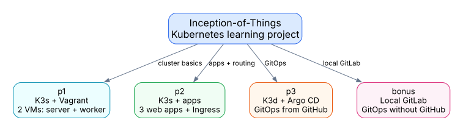
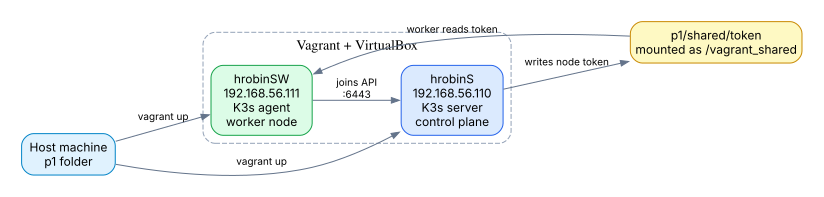
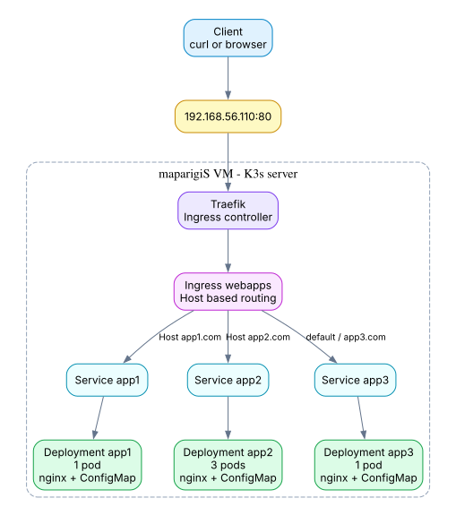
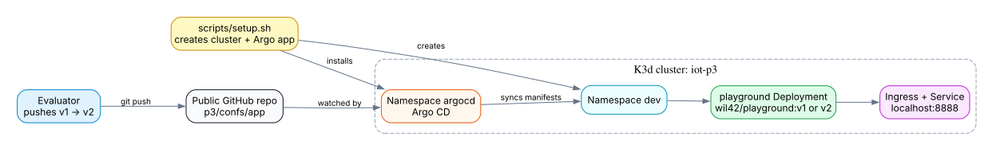
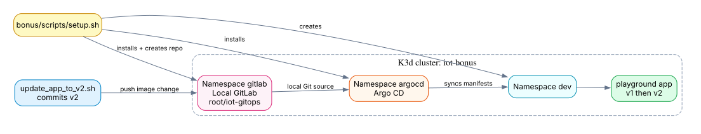
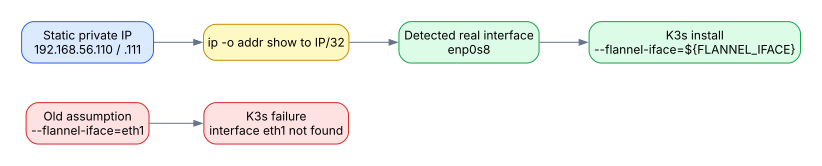

# Inception-of-Things Visual Diagrams

This file embeds real SVG diagrams generated with Graphviz. They should display in normal Markdown preview without needing Mermaid support.

The editable sources are in:

```text
diagrams/src/*.dot
```

The rendered images are in:

```text
diagrams/svg/*.svg
```

To regenerate them after editing the `.dot` files:

```sh
dot -Tsvg diagrams/src/global.dot -o diagrams/svg/global.svg
dot -Tsvg diagrams/src/p1.dot -o diagrams/svg/p1.svg
dot -Tsvg diagrams/src/p2.dot -o diagrams/svg/p2.svg
dot -Tsvg diagrams/src/p3.dot -o diagrams/svg/p3.svg
dot -Tsvg diagrams/src/bonus.dot -o diagrams/svg/bonus.svg
dot -Tsvg diagrams/src/interface-fix.dot -o diagrams/svg/interface-fix.svg
```

## Global View

The subject is split into three mandatory parts and one bonus. Each part adds one new Kubernetes concept.



## Part 1: K3s and Vagrant

Part 1 creates two Vagrant machines. The server starts the Kubernetes control plane. The worker joins that server using the token copied through the shared folder.



## Part 2: K3s and Three Applications

Part 2 uses one VM. K3s runs in server mode and also runs the app pods. Traefik reads the Ingress and routes requests based on the HTTP `Host` header.



## Part 3: K3d and Argo CD

Part 3 replaces Vagrant-based Kubernetes with K3d. Argo CD watches the public GitHub repository and applies the app manifests into the `dev` namespace.



## Bonus: Local GitLab

The bonus keeps the Part 3 GitOps idea, but replaces GitHub with a local GitLab instance running in the cluster.



## Interface Detection Fix

This issue appears in both Part 1 and Part 2. The subject warns that modern Linux distributions may not use `eth1`. The scripts solve that by detecting the interface from the expected private IP.



## What to Show During Evaluation

Use the diagrams above as a correction path:

1. Show `p1`: two VMs, server token, worker joins, `kubectl get nodes`.
2. Show `p2`: apps, Services, Ingress, app2 replicas, Host-header routing.
3. Show `p3`: K3d cluster, Argo CD, `dev` namespace, v1 to v2 GitOps update.
4. Show `bonus`: local GitLab in `gitlab`, Argo CD syncing from GitLab, v1 to v2 update.
